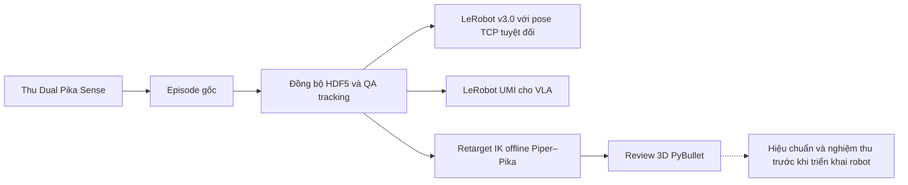

# Quy trình Dual Pika Sense

Dual Pika Sense và Vive ghi pose, độ mở gripper và ảnh hai cổ tay. Có thể ghi
thêm camera head đã cấu hình. Xem [hướng dẫn khởi động cảm biến và thu](../../README.md#5-starting-sensors--stream-preflight-sensors--status---check-streams).



## Từ episode gốc đến dataset

Chạy từ gốc workspace. Ví dụ dùng episode 54 ở 30 Hz với hai camera cổ tay.
Bỏ `--exclude-head` để giữ camera head nếu episode đã ghi stream đó.

```bash
export PIKA_PYTHON="$PWD/.venv-pika-dataset/bin/python"
export PIKA_VLA_PYTHON="$PIKA_PYTHON"
raw="/đường/dẫn/tới/raw"
run="/đường/dẫn/tới/processed/pika_54"

./pika_data.sh export 54 --data-root "$raw" --output-root "$run" --fps 30 --exclude-head
./pika_data.sh prepare 54 --data-root "$raw" --output-root "$run"
./pika_data.sh lerobot 54 --output-root "$run" --output-dir "$run/pika-tcp" \
  --repo-id local/pika_tcp --representation pika-tcp
```

`export` đồng bộ ảnh, Vive pose và gripper vào HDF5. `prepare` lọc các khoảng
mất tracking, chuyển động bất thường và đoạn hợp lệ quá ngắn. Đọc
`prepared/episode54/report.json` để xem các lý do loại frame. Mặc định dùng
hai file intrinsics và hai file Pika TCP trong `data/calibration/`.

`pika-tcp` ghi hai pose TCP tuyệt đối trong cùng hệ Vive, theo thứ tự
`[left_pose7, right_pose7, left_width, right_width]`. Pose dùng mét và
quaternion XYZW. `observation.state` là thời điểm hiện tại, `action` là TCP
và độ mở tiếp theo trong cùng đoạn đã qua QA. Dataset lưu video, provenance
và nhận diện schema trong `meta/info.json`. Export UMI mặc định vẫn dùng
state 11D và action delta TCP 14D cho VLA.

## Retarget IK và kiểm tra 3D

```bash
./pika_data.sh review --session-dir "$run" --episode 54 \
  --output-dir "$run/ik_54" --ik-only
```

`review` đọc chính các đoạn đã qua QA, áp dụng IK trên mô hình Piper–Pika,
và ghi `ik_solution.npz` cùng `review.json`. Xem sai số pose và số bước vượt
giới hạn vận tốc trong báo cáo. Để ghi video 3D, cài dependencies trong
`Pika_Data/data_tools/requirements-review.txt` và chạy lại với thư mục đầu ra
mới, bỏ `--ik-only`. Nếu cài dependencies vào thư mục riêng, truyền
`--pybullet-dir` trỏ vào thư mục đó.

Quy trình hiện dùng bộ lọc timestamp/tracking của Pika và IK/PyBullet đang có
trong workspace. Dataset `pika-tcp` mang schema riêng cho pose TCP đã hiệu
chuẩn. Để nối vào HandUMI PyRoKi/MuJoCo cần adapter cho schema Pika và kiểm tra
hệ tọa độ robot đích. Triển khai robot thật cần phép hiệu chuẩn từ hệ Vive
tới hai base Piper, kiểm tra giới hạn tốc độ và nghiệm thu backend cho rig.
Đầu ra của `review` dùng để đánh giá offline.

## Xuất joint action cho VLA

Dùng `piper-joint` để giải IK offline trên các đoạn đã qua QA. Mỗi lần xuất
dùng một cấu hình hiệu chuẩn cố định cho các episode cùng hệ Vive. JSON
hiệu chuẩn chứa `source_frame`, `status` (`provisional` hoặc `calibrated`)
và hai cặp ma trận SE(3) 4×4 theo mét, mỗi cặp có key `left` và `right`.

- `base_from_vive` đưa pose trong hệ Vive về từng base Piper.
- `flange_from_pika_tcp` đưa pose TCP theo trục Pika về flange `link6`. Dùng
  ma trận đã quy về trục Pika một lần. Nếu JSON đo mới chỉ có trục song
  song với flange, nhân thêm `R_y(-π/2)` phía bên phải.

```bash
./pika_data.sh lerobot 54 --output-root "$run" \
  --output-dir "$run/lerobot_piper_joint" --repo-id local/piper_joint \
  --format-version v2.1 --representation piper-joint \
  --ik-calibration /đường/dẫn/ik_calibration.json
```

Đầu vào cần được xuất với `--exclude-head`. Dataset có hai video cổ tay và
vector 14D `[q_L1…q_L6, w_L, q_R1…q_R6, w_R]` theo radian và mét.
`observation.state[t]` là nghiệm IK hiện tại và `action[t]` là nghiệm kế
tiếp. Bộ xuất kiểm tra cả hai đầu của mỗi bước với sai số TCP tối đa 5 mm
và 5°, giới hạn góc/vận tốc URDF và miền độ mở 0–100 mm. Các đoạn còn lại
được cắt theo vùng hợp lệ và cần đạt độ dài tối thiểu từ bước `prepare`.
Nếu JSON có `table_top_z_m`, bộ lọc kiểm tra phần thấp nhất của hình học
ngón kẹp so với mặt bàn ngang ở cao độ đó trong hệ base robot.
Xem `piper_ik_reports.json` để biết số bước bị lọc theo từng episode.

Khi dùng Pi0.5, cấu hình policy theo state/action 14D và giữ
`--policy.use_delta_action=false`. Chia train/validation theo episode gốc
trong `pika_source_reports.json`, rồi chọn đoạn đủ dài cho action chunk.
Các checkpoint UMI 11D/14D giả định layout và normalization khác. Dữ liệu
gắn `status=provisional` phù hợp để kiểm tra loader và thử nghiệm offline.
Chất lượng cho train theo tác vụ phụ thuộc vào việc giữ đủ pha thao tác của
mỗi demo và hiệu chuẩn đúng rig đích.

## Xem từng episode joint đã xuất

`review-joints` đọc trực tiếp Parquet và hai video cổ tay trong dataset
LeRobot v2.1. Số episode là `episode_index` của LeRobot, bắt đầu từ 0.
Dùng `--list` để xem episode gốc tương ứng.

```bash
dataset="data/processed/piper_100_contiguous_qa.YKVKAY/lerobot_joint_v21_100_contiguous"
./pika_data.sh review-joints --dataset "$dataset" --list
./pika_data.sh review-joints --dataset "$dataset" --episode 0 90
./pika_data.sh review-joints --dataset "$dataset" --all --resume
```

Mỗi thư mục `episode_NNNNNN` có `review.mp4`, `poster.png` và
`review.json`. Mặc định đặt thư mục review cạnh dataset, có thể đổi bằng
`--output-root`. `--resume` bỏ qua episode đã render xong của dataset đó.

Video hiển thị hai tay Piper–Pika theo `observation.state[t]` đồng bộ với
hai video cổ tay ở frame `t`. Bước `action` cuối được tính trong kiểm tra
tốc độ, giới hạn khớp và khoảng hở mặt bàn. Sai số TCP từ lần xuất, nếu có
trong provenance, xuất hiện trên video. Đây là mô phỏng động học URDF.
Cần môi trường Python dùng để xuất LeRobot, thư viện OSMesa
(`libosmesa6` trên Ubuntu), font DejaVu và các mesh Piper/Pika trong
workspace. Có thể chọn Python qua `PIKA_VLA_PYTHON`.
