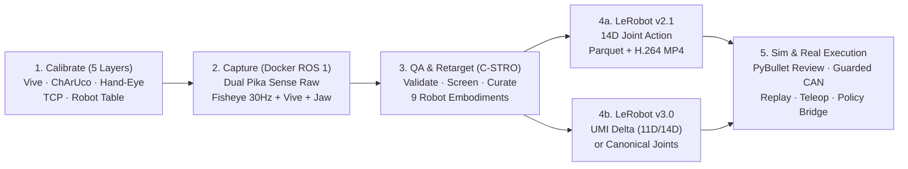

# `pikaumi` — Dual Pika Sense Capture, 5-Layer Calibration & Multi-Robot Retargeting

End-to-end robotics framework for **robot-free Dual Pika Sense bimanual demonstration capture**, **SHA-256 gated 5-layer calibration**, **C-STRO multi-robot retargeting** (9 embodiments, led by Dual AgileX Piper + 100 mm Pika grippers), **LeRobot v2.1 / v3.0 dataset export**, and **guarded SocketCAN real-robot replay & SE(3) policy control**.

> **Target Hardware:** Dual Pika Sense handheld rigs (30 Hz unrectified fisheye RGB + 120–250 Hz Vive Tracker + 100 mm jaw encoder) and two 6-DoF AgileX Piper arms equipped with **100 mm-stroke Pika grippers** (Firmware `S-V1.8-9`, `can0` left / `can1` right).

---

## Architecture Overview



---

## 1. Installation & New-Machine Handover

### Prerequisites
- **OS:** Ubuntu 22.04 / 24.04 with Python `>= 3.11` (3.12 recommended)
- **Tools:** `git`, `docker` (for `pika-ros` ROS 1 sensor stack), `uv` (recommended), SocketCAN (`iproute2`) for live Piper control

### Quick Setup
```bash
git clone <your-repo-url> quang_ws
cd quang_ws

# 1. Create .venv and install pikaumi (with dataset export, sim, and Piper CAN support)
bash install.sh --extras=dataset,sim,piper

# 2. (Optional, hardware capture machine) Install Vive & Pika USB udev rules
bash install.sh --extras=dataset,sim,piper --install-udev

# 3. Create machine-local hardware configs (never committed to Git)
./pika setup --init-rig
cp Pika_Data/config/sensors.example.yaml Pika_Data/config/sensors.yaml
# -> Edit configs/rig.yaml and Pika_Data/config/sensors.yaml with your USB paths, CAN ports, and LHR-* Vive IDs
# -> Helper to find USB kernel paths: bash Pika_Data/scripts/find_usb_kernel.bash

# 4. (Capture machine) Build the Docker ROS 1 sensor container
docker build -t pika-ros Pika_Data/

# 5. Run full offline health check (190+ pytest tests, doctor, mock policy-bridge smoke test)
bash bootstrap_env.sh
```

Verify available CLI commands and registered embodiments:
```bash
./pika doctor
./pika robots list
./pika robots info piper_pika
```

---

## 2. Five-Layer Calibration Workflow

Every calibration artifact carries SHA-256 provenance verified before dataset export or live robot motion.

### Layer 1 — Vive Lighthouse & Tracker Stability
Run once whenever a Lighthouse base station is moved (never concurrently with `./pika sensors`):
```bash
docker exec -it pika-ros bash -lc "survive-cli --force-calibrate"
```

### Layer 2 & 3 — Fisheye Intrinsics, ChArUco Hand-Eye & Tabletop Session Frame
Default ChArUco board: `4×5` squares, `45 mm` square length, `35 mm` marker length, `DICT_4X4_50`.

```bash
# Start Pika ROS 1 sensors in a dedicated terminal first
./pika sensors --camera-fps 30

# (A) Fisheye camera intrinsics (Kannala-Brandt model)
python3 Pika_Data/scripts/calibrate_charuco_fisheye.py capture --side left --output data/calibration/left_imgs
python3 Pika_Data/scripts/calibrate_charuco_fisheye.py calibrate --input data/calibration/left_imgs --output data/calibration/left_fisheye_intrinsics.json
# Repeat for --side right, then import into standardized spatial.yaml:
./pika calibrate import-legacy --legacy-dir data/calibration --output-dir data/calibration_std

# (B) Rigid Hand-Eye mount (T_tracker_cam) via ChArUco + Vive (repeat for --side right)
./pika calibrate capture-charuco \
  --mode hand-eye \
  --side left \
  --spatial-yaml data/calibration_std/spatial.yaml \
  --output data/calibration_std/obs_handeye_left.json \
  --views 30

./pika calibrate hand-eye \
  --observations-json data/calibration_std/obs_handeye_left.json \
  --side left \
  --spatial-yaml data/calibration_std/spatial.yaml \
  --output data/calibration_std/hand_eye_left.yaml

# (C) Tabletop session frame (T_table_vive) — place ChArUco flat at table origin (+X right, +Y away, +Z up)
./pika calibrate capture-charuco \
  --mode session \
  --side left \
  --spatial-yaml data/calibration_std/spatial.yaml \
  --output data/calibration_std/obs_session.json \
  --views 15

./pika calibrate session \
  --observations-json data/calibration_std/obs_session.json \
  --spatial-yaml data/calibration_std/spatial.yaml \
  --output data/calibration_std/session.yaml
```

### Layer 4 — Pika Tracker-to-TCP (`pika_tcp.yaml`) & Chain Verification
```bash
# Pivot translation fit (optional if reusing verified pika_tcp.yaml)
./pika calibrate tcp-pivot --poses-json data/calibration_std/pivot_left.json --side left --output data/calibration_std/tcp_left.yaml

# 3-axis SVD orientation recovery
./pika calibrate tcp-axes --directory data/calibration_std/axes_snapshots --distance-mm 80 --output data/calibration_std/tcp_axes.yaml

# Verify SHA-256 chain & optional two-tip touch accuracy
./pika calibrate verify --calibration-dir data/calibration_std
```

### Layer 5 — Robot-to-Table Deployment Calibration (`T_robot_table`)
Saved privately to `configs/calibration/table/local/piper_pika.yaml` (`scope: physical`, `verified: true`, gitignored).

**Option A — Interactive Read-Only 3-Point Touch (Teach Mode, zero CAN TX):**
Touch 3 points on the table (`O` origin → `+X` axis → `+Y` plane, spaced **25–35 cm** apart at ~90° with gripper closed to `0 mm`):
```bash
./pika calibrate capture-table-robot \
  --robot piper_pika \
  --side right \
  --source can \
  --port can1 \
  --output configs/calibration/table/local/piper_pika.yaml
```

**Option B — Direct Mechanical Measurement (HandUMI style, recommended for flat rails):**
Measure the ChArUco center `(x, y, z)` relative to the midpoint of the two Piper bases (URDF default base separation: `62.5 cm`, `left y = +0.3125 m`, `right y = -0.3125 m`) and copy `configs/calibration/table/local/example.yaml` → `configs/calibration/table/local/piper_pika.yaml` with flat orientation `quaternion: [0.0, 0.0, -0.70710678, 0.70710678]` (`yaw = -90°`, `tilt = 0°`).

---

## 3. Dual Pika Sense Data Collection & QA

```bash
# Terminal 1: Launch sensors (single-instance locked)
./pika sensors --camera-fps 30

# Terminal 2: Verify sync & Vive tracking accuracy before recording
./pika status --check-streams

# Record demonstrations (GUI session manager or terminal single-episode)
./pika session
# or:
./pika record 10 "take a teddy bear and place it into a cardboard box" --data-root /path/to/raw
```

To use RealSense D405 wrist RGB, pass `--wrist-camera d405` to sensors, the stream check, and capture.
Stop the existing sensor process before switching modes.

```bash
# Terminal 1
./pika sensors --camera-fps 30 --wrist-camera d405

# Terminal 2
./pika status --check-streams --wrist-camera d405
./pika session --wrist-camera d405
# Or record one episode
./pika record 10 "fold a towel" --wrist-camera d405
```

New captures default to fisheye. An existing session reuses its saved wrist camera mode.
For 60 Hz raw wrist RGB and a 60 Hz dataset, use:

```bash
# Terminal 1
./pika sensors --camera-fps 60 --wrist-camera d405

# Terminal 2
./pika status --check-streams --wrist-camera d405 --fps 60
./pika session --wrist-camera d405 --fps 60
# Or record one episode and remember 60 Hz for subsequent export
./pika record 10 "fold a towel" --wrist-camera d405 --fps 60
```

`--fps` accepts any integer from 5 through 90 Hz for the alignment grid and export.
When omitted during export, the rate comes from the recording metadata or defaults to 20 Hz.
Both D405 and the Pika fisheye cameras support `--camera-fps 15`, `30`, `60`, and `90` at 640×480.
The stream check prints the measured RGB rates. Export can reuse frames if a source camera is slower than the dataset rate.
For D405, use the session's Convert button or the `./pika_data.sh export` → `prepare` → `lerobot` workflow.
The separate `./pika import-raw` and `./pika convert-v21` workflows below expect fisheye recordings.

Run multi-robot QA & screening (optional before export):
```bash
./pika import-raw \
  --input-dir /path/to/raw \
  --output-dir data/pika_raw \
  --calibration-dir data/calibration_std \
  --fps 30

./pika dataset qa data/pika_raw --robots piper_pika --solver cstro
./pika dataset curate data/pika_raw --output-dir data/pika_curated --robot piper_pika --exclude 18 62 63 64
```

---

## 4. Dataset Conversion

### Track A — Direct Parallel Export to LeRobot v2.1 (14D Joint Action)
Directly converts raw Dual Pika episodes (`episode0/`, `episode1/`, ...) using verified 5-layer calibrations and C-STRO bimanual IK into a strict **LeRobot v2.1** dataset (Parquet with HuggingFace `FixedSizeList<float32>[14]` metadata + H.264 `yuv420p` 30 fps MP4 + full `meta/` stats):

```bash
./pika convert-v21 /path/to/raw \
  --output-dir /path/to/piper_pika_joints_v21 \
  --calibration-dir data/calibration_std \
  --robot piper_pika \
  --solver cstro \
  --exclude 18,62,63,64 \
  --fps 30 \
  --min-segment-seconds 1.0 \
  --workers 12 \
  --require-physical-table
```

### Track B — LeRobot v3.0 (`robot-joints` or `umi-delta` 11D/14D VLA)
```bash
# Canonical joint-space (for replay & joint-space policies)
./pika convert data/pika_curated \
  --output-dir data/piper_joints \
  --format robot-joints \
  --robot piper_pika \
  --solver cstro

# Robot-free UMI relative-TCP / local-delta (for VISTA / pi0.5)
./pika convert data/pika_curated \
  --output-dir data/umi_delta \
  --format umi-delta

# Optional follower layout export
./pika dataset export data/piper_joints --layout bi_piper_pika_follower --output-dir data/follower_piper_pika
```

### Tensor Contract & Training Notes
| Track | `observation.state` | `action` | Wrist Images |
| :--- | :--- | :--- | :--- |
| **`convert-v21` / `robot-joints`** | `(14,)` `[L_j1..6_rad, L_width_m, R_j1..6_rad, R_width_m]` | `(14,)` next absolute joint target `state[t+1]` | `observation.images.{left,right}_wrist` (`480×640`, unrectified fisheye RGB, H.264 `yuv420p`) |
| **`umi-delta`** | `(11,)` Right TCP in Left TCP `[xyz, rot6d, w_L, w_R]` | `(14,)` `[L_delta6, w_L(t+1), R_delta6, w_R(t+1)]` | Same unrectified fisheye (`enable_fisheye=False` at train/eval) |

- Always split `train/val` strictly by **`source_episode`** using `pika_source_reports.json` (never split segments of the same raw episode across train and val).
- When training VLA policies on `umi-delta`, keep `--policy.use_delta_action=false` and `use_corr_state=false`.

---

## 5. Offline Review & Real Dual-Piper Replay

> [!CAUTION]
> **AgileX Piper Firmware `S-V1.8-9` Safety Rules:**
> - Never call `DisableArm` (`0x150/01`) or `Reset` (`0x150/02`) as a fault fallback — torque release drops the arm under gravity. `pikaumi` enforces `HOLD_LAST_SAFE` on any fault/timeout/jump and verifies zero forbidden SDK calls via AST unit tests.
> - Always clear the workspace, exit Teach Mode manually while physically supporting both arms, keep E-stop in hand, and pass `--live --operator-supported --enable-arms` explicitly.

### Offline Simulation & Preflight (Zero Hardware I/O)
```bash
# Offline 3D PyBullet trajectory video + wrist views
./pika replay-joints data/piper_joints --episode 0 --output-dir outputs/sim_ep0 --sim-video

# Dry-run preflight & mock-robot check before touching hardware
./pika replay-real data/piper_joints --episode 0 --robot piper_pika --mock-robot --speed-scale 0.3
```

### Activate SocketCAN Interfaces (Once per Power Cycle)
```bash
sudo ip link set can0 down 2>/dev/null || true
sudo ip link set can1 down 2>/dev/null || true
sudo ip link set can0 up type can bitrate 1000000
sudo ip link set can1 up type can bitrate 1000000
```

### Live Real-Robot Replay (With 3-Stage Anti-Vibration Smoother)
The live streamer includes a 3-stage smoother (`--smooth-cutoff-hz` zero-phase Butterworth + `--stream-hz` clamped $C^2$ cubic spline + `--tracking-filter-hz` 3rd-order critically-damped tracking filter) to eliminate step vibration at slow `--speed-scale`:

```bash
./pika replay-real data/piper_joints \
  --episode 0 \
  --robot piper_pika \
  --live --operator-supported --enable-arms \
  --ramp-speed-deg-s 10 \
  --speed-scale 0.3 \
  --speed-percent 20 \
  --smooth-cutoff-hz 3.0 \
  --stream-hz 100 \
  --tracking-filter-hz 5.0
```

### Policy Bridge & Online Teleop (Dry-Run Default)
```bash
# Offline mock policy bridge smoke test
./pika policy-bridge --robot piper_pika --fps 30 --steps 10

# Live SE(3) policy server execution (explicit hardware flags required)
./pika policy-bridge \
  --robot piper_pika \
  --policy-url http://127.0.0.1:8000/act \
  --task "take a teddy bear and place it into a cardboard box" \
  --live --operator-supported --enable-arms --speed-percent 30
```

---

## 6. Repository Layout

```text
quang_ws/
├── pyproject.toml                  # Hatchling package metadata (pikaumi)
├── install.sh                      # New-machine .venv + editable install + udev helper
├── bootstrap_env.sh                # Offline dependency, skill, pytest & smoke verification
├── pika / pk                       # Portable CLI wrapper (auto-detects .venv)
├── pika_data.sh                    # Backward-compatible legacy Pika_Data wrapper
├── src/pikaumi/                    # Core Python package
│   ├── calibration/                # 5-layer gated calibration & SHA-256 verification
│   ├── dataset/                    # pika_raw, QA/screening, umi-delta, canonical, lerobot_v21
│   ├── retargeting/                # C-STRO global optimizer, HandUMI-LM, Myopic-DLS
│   ├── robots/                     # General N-DoF URDF loader & 9-robot registry
│   ├── sim/                        # Offline 3D replay & PyBullet renderer
│   └── real/                       # pyAgxArm/piper_sdk driver, 3-stage smoother, HOLD_LAST_SAFE
├── configs/
│   ├── rig.example.yaml            # Machine-local rig template (copy -> configs/rig.yaml)
│   ├── quality.yaml                # QA thresholds
│   ├── robots/*.yaml               # 9 declarative robot embodiment configs
│   └── calibration/
│       ├── pika_tcp/               # Verified Pika Sense tracker->TCP offsets
│       └── table/{sim,local}/      # Simulation defaults & private physical lab calibrations
├── assets/                         # Self-contained URDFs & meshes for all 9 robots
├── Pika_Data/                      # ROS 1 Noetic Docker capture stack & sensors.example.yaml
├── docs/                           # C-STRO paper notes & new-embodiment onboarding guide
└── tests/                          # Offline unit & hardware-safety regression suite
```

### Further Reading
- [C-STRO Paper Notes & 9-Robot Benchmark](docs/CSTRO_PAPER_NOTES.md)
- [Adding a New Robot Embodiment](docs/NEW_EMBODIMENT.md)
- [Dual Pika Sense Sensor & Docker Setup](Pika_Data/docs/PIKA_WORKFLOW.md)
