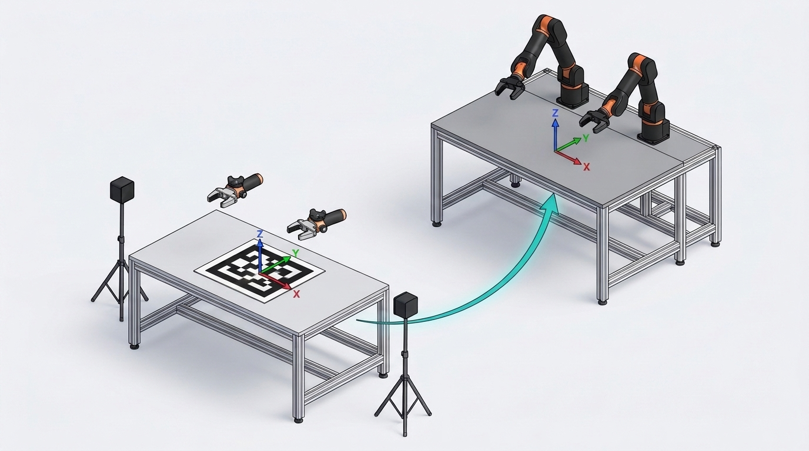
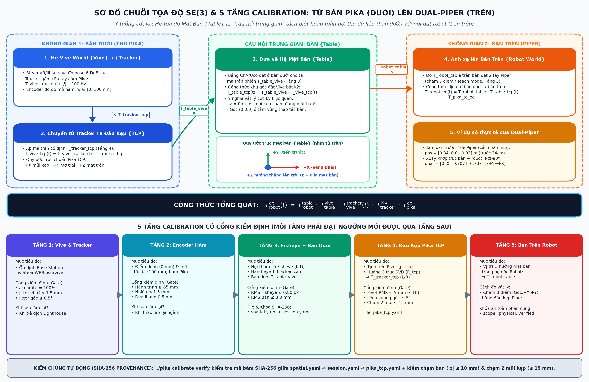
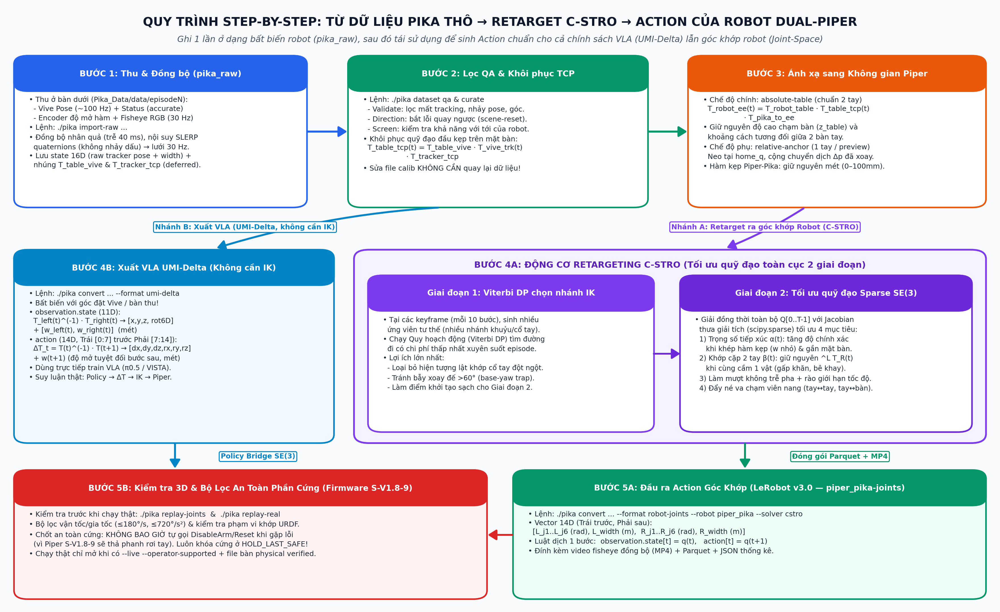

# Hướng dẫn Trực quan: Hệ thống Calibration 5 Tầng & Ánh xạ Tọa độ từ Bàn Pika (Dưới) lên Dual-Piper (Trên)

> **Mục tiêu tài liệu:** Giúp bạn dễ dàng trình bày và giải thích cho đồng nghiệp, giảng viên hoặc thành viên mới hiểu rõ toàn bộ luồng từ **hiệu chuẩn (Calibration)** → **chuyển không gian làm việc giữa 2 bàn khác nhau** → **Retargeting sinh Action chuẩn cho robot Dual-Piper (và các robot khác)** chỉ trong vài phút.

---

## 1. Bức tranh tổng thể trong 1 phút (Giải thích bằng trực giác)

Hãy tưởng tượng bài toán thực tế trong phòng lab của chúng ta:
- **Ở bàn phía dưới (hoặc bàn phía sau):** Người thao tác cầm 2 tay cầm **Pika Sense** (gắn cục **Vive Tracker**, **camera fisheye cổ tay** và **encoder đo độ mở hàm 0–100 mm**) để thực hiện động tác (ví dụ: gấp khăn, nhặt đồ).
- **Ở bàn phía trên (hoặc phía trước):** Đặt 2 cánh tay robot **AgileX Piper 6-DoF** cũng gắn đúng cặp **hàm kẹp Pika 100 mm**.



### Câu hỏi lớn nhất: *Làm sao để động tác ở bàn dưới dịch chuyển chính xác lên bàn trên mà không cần đặt 2 bàn chồng lên nhau?*

**Bí quyết cốt lõi: Dùng Hệ tọa độ Mặt Bàn `{Table}` làm "tờ giấy kẻ ô chuẩn" (cầu nối trung gian)!**

Hãy giải thích cho người nghe bằng ẩn dụ rất đời thường:
1. Bạn vẽ một **hệ trục tọa độ chuẩn `{Table}`** (gốc $(0,0,0)$ nằm ngay tâm vùng làm việc trên mặt bàn, $+X$ sang phải, $+Y$ hướng về phía trước, $+Z$ hướng thẳng lên trời nên $z = 0$ chính là mặt bàn).
2. **Ở bàn dưới (lúc thu dữ liệu):** Ta đo xem *mũi kẹp Pika đang ở đâu so với "tờ giấy kẻ ô" ở bàn dưới* → ví dụ: *"mũi kẹp trái đang ở bên trái tâm bàn 15 cm, tiến lên 4 cm, cao hơn mặt bàn 5 cm"*.
3. **Ở bàn trên (lúc robot chạy):** Ta đo xem *"tờ giấy kẻ ô" đó đang nằm ở vị trí nào trước mặt 2 đế robot Piper* → ví dụ: *"tâm mặt bàn nằm phía trước 2 đế Piper 34 cm, thấp hơn mặt phẳng đế 3 cm"*.
4. **Kết quả:** Khi ghép 2 bước trên lại, mọi điểm chạm mặt bàn ở bàn dưới ($z = 0$) sẽ **tự động chạm đúng mặt bàn ở bàn trên**, và khoảng cách giữa 2 bàn tay khi cùng cầm một vật được bảo toàn tuyệt đối theo tỷ lệ 1:1 (mét thật)!

> **Lợi ích cực lớn của kiến trúc này (Deferred Calibration):**
> Dữ liệu thô [`pika_raw`](../src/pikaumi/dataset/raw.py) chỉ lưu pose gốc của Tracker + đính kèm thông số hiệu chuẩn. Nếu bạn đổi bàn đặt robot, dịch chuyển robot, hoặc đổi sang robot khác (9 loại robot trong `configs/robots/`), **bạn KHÔNG BAO GIỜ phải quay lại dataset** — chỉ cần cập nhật đúng file hiệu chuẩn mặt bàn `T_robot_table` rồi chạy lại bước convert!

---

## 2. Sơ đồ chuỗi tọa độ SE(3) & Kiến trúc Calibration 5 tầng

Mọi phép biến đổi trong không gian 3D đều là ma trận biến đổi cứng $4 \times 4 \in SE(3)$ gồm ma trận xoay $R \in SO(3)$ và vector tịnh tiến $p \in \mathbb{R}^3$. Trong code `pikaumi`, mỗi ma trận được lưu gọn dưới dạng `pose7 = [x, y, z, qx, qy, qz, qw]` (mét, quaternion chuẩn `xyzw`).



### Quy ước 4 hệ tọa độ cần nhớ

| Ký hiệu hệ trục | Nằm ở đâu? | Quy ước hướng trục trong `quang_ws` |
|---|---|---|
| `{Vive}` | Hệ tọa độ thế giới của SteamVR / `libsurvive` | Tự sinh theo 2 trạm đèn Vive Lighthouse (bất kỳ, có thể nghiêng/xoay mỗi lần calib lại Lighthouse). |
| `{Tracker}` | Cục Vive Tracker gắn cứng trên thân tay cầm Pika Sense | Cố định theo vỏ phần cứng Vive Tracker. |
| `{TCP}` | **Điểm tâm giữa 2 đầu ngón kẹp** (Tool Center Point) của Pika | **`+X`**: từ cổ tay ra mũi kẹp · **`+Y`**: hướng mở hàm bên trái · **`+Z`**: hướng lên mặt trên thân Pika. |
| `{Table}` | **Mặt bàn làm việc chuẩn** (định nghĩa bởi bảng ChArUco) | **`+X`**: sang phải · **`+Y`**: tiến về phía trước · **`+Z`**: hướng thẳng lên trời (**$z = 0$ là mặt bàn**). |
| `{Robot}` | Hệ gốc trung tâm giữa 2 đế cánh tay Dual-Piper | **`+X`**: hướng robot vươn về phía trước · **`+Y`**: sang bên trái robot · **`+Z`**: hướng lên trên. |

---

## 3. Giải thích chi tiết 5 Tầng Calibration có Cổng Kiểm Định (Gated Calibration)

Hệ thống chia việc hiệu chuẩn thành **5 tầng độc lập**. Tầng trước phải đạt ngưỡng sai số (**Gate**) thì mới sang tầng sau, và toàn bộ được khóa chéo bằng mã băm **SHA-256** để không bao giờ dùng nhầm file calib cũ cho dữ liệu mới.

### Tầng 1: Kiểm định Vive Lighthouse & Tracker (`vive.py`)
- **Mục tiêu:** Đảm bảo 2 đèn Lighthouse định vị ổn định, không bị nhiễu phản xạ gương/kính và không mất tracking.
- **Cách thực hiện:** Đặt 2 tay cầm Pika đứng yên trên bàn thu, chạy `./pika sensors` (1 phiên duy nhất) rồi kiểm tra bằng `./pika status --check-streams`. Nếu vừa di chuyển chân đế Lighthouse, chạy `survive-cli --force-calibrate` (khi không chạy `sensors`).
- **Cổng kiểm định (Gate) trong [`evaluate_stationary_vive_window`](../src/pikaumi/calibration/vive.py):**
  - Tỷ lệ khung hình `accurate == True` phải đạt **100%**.
  - Độ rung vị trí (jitter): $\sigma_{\text{pos}} \le 1.5\text{ mm}$.
  - Độ rung góc xoay: $\sigma_{\text{ori}} \le 0.5^\circ$.
- **Khi nào phải làm lại?** Chỉ khi bạn di chuyển hoặc đụng lệch chân đế Vive Lighthouse.

---

### Tầng 2: Hiệu chuẩn Encoder độ mở hàm kẹp Pika (`gripper.py`)
- **Mục tiêu:** Ánh xạ giá trị đọc thô từ cảm biến encoder tay cầm sang độ mở vật lý chính xác $w \in [0.00, 0.10]\text{ m}$ (đúng hành trình **100 mm** của hàm Pika, khác với hàm Piper mặc định 70–80 mm).
- **Cách thực hiện:** Thu mẫu ở 2 trạng thái: bóp kín hoàn toàn ($w_{\text{closed}}$) và mở hết cỡ ($w_{\text{open}}$).
- **Công thức chuẩn hóa tuyến tính trong [`calibrate_gripper_encoder`](../src/pikaumi/calibration/gripper.py):**
  $$w_{\text{m}} = \mathrm{clip}\!\left(\frac{w_{\text{raw}} - w_{\text{closed}}}{w_{\text{open}} - w_{\text{closed}}} \cdot 0.10,\; 0,\; 0.10\right)$$
  (kèm vùng chết `deadband = 0.5 mm` để khép kín hoàn toàn về `0.0` khi đóng hàm).
- **Cổng kiểm định (Gate):** Hành trình đo được $\ge 85\text{ mm}$, độ nhiễu $\le 1.5\text{ mm}$.
- **Khi nào phải làm lại?** Chỉ khi tháo lắp lại cơ cấu ngàm hoặc thay encoder.

---

### Tầng 3: Nội tham số Camera Fisheye, Hand-Eye & Mặt bàn dưới (`spatial.py`)
Tầng này gồm 3 phần nối tiếp nhau, kết nối camera cổ tay với Vive Tracker và **tạo ra ma trận $T_{\text{table}}^{\text{vive}}$ cho bàn dưới**:

1. **Nội tham số Fisheye Kannala-Brandt ($K, D_4$):**
   - Dùng bộ ảnh bảng bàn cờ/ChArUco nhiều góc chụp để tìm ma trận nội tham số $K$ ($3 \times 3$) và 4 hệ số méo ống kính fisheye $D = [k_1, k_2, k_3, k_4]$.
   - *Thực tế trên workspace của bạn:* File `data/calibration/{left,right}_fisheye_intrinsics.json` đã được hiệu chuẩn rất tốt (**RMS = 0.148 px** trên 44 góc chụp, thấp hơn nhiều so với ngưỡng Gate $\le 0.80\text{ px}$).
2. **Hiệu chuẩn Hand-Eye cố định trên tay cầm ($T_{\text{tracker}}^{\text{cam}}$):**
   - Gắn cố định 1 bảng ChArUco trên bàn, lia tay cầm Pika qua $N \ge 6$ tư thế đa dạng. Với mỗi góc nhìn $i$, ta có phương trình khép kín vòng tọa độ (vì bảng đứng yên trong hệ Vive):
     $$T_{\text{vive}}^{\text{tracker}}(i) \cdot T_{\text{tracker}}^{\text{cam}} \cdot T_{\text{cam}}^{\text{board}}(i) = T_{\text{vive}}^{\text{board}}$$
   - Hàm [`solve_hand_eye_mount`](../src/pikaumi/calibration/spatial.py) giải đồng thời $T_{\text{tracker}}^{\text{cam}}$ và $T_{\text{vive}}^{\text{board}}$ bằng tối ưu phi tuyến **Huber SE(3)** (Gate: RMS $\le 5\text{ mm}$), lưu vào `spatial.yaml`.
3. **Hiệu chuẩn Mặt bàn dưới theo từng phiên thu ($T_{\text{table}}^{\text{vive}}$):**
   - Đặt tấm bảng ChArUco nằm phẳng ngay tâm vùng thao tác của **bàn dưới**.
   - Dùng tay cầm Pika nhìn vào bảng từ vài góc độ. Với mỗi khung hình $i$, vị trí bàn trong hệ Vive là:
     $$T_{\text{vive}}^{\text{table}}(i) = T_{\text{vive}}^{\text{tracker}}(i) \cdot T_{\text{tracker}}^{\text{cam}} \cdot T_{\text{cam}}^{\text{table}}(i)$$
   - Lấy trung bình **Huber SE(3)** trên nhiều góc nhìn rồi đảo ngược một lần ([`solve_session_table_from_vive`](../src/pikaumi/calibration/spatial.py)):
     $$T_{\text{table}}^{\text{vive}} = \Big(\mathrm{Avg}_{\text{Huber}}\!\big(T_{\text{vive}}^{\text{table}}(i)\big)\Big)^{-1}$$
   - **Cổng kiểm định (Gate):** RMS sai số mặt bàn $\le 8.0\text{ mm}$. Lưu vào `session.yaml` kèm chữ ký `spatial_sha256`.
   - **Lệnh CLI:** `./pika calibrate session --observations-json ... --spatial-yaml ... --output session.yaml`

---

### Tầng 4: Hiệu chuẩn Đầu Kẹp Pika TCP ($T_{\text{tracker}}^{\text{tcp}}$ — `pika_tcp.py`)
Vive Tracker nằm ở phần đuôi/thân tay cầm, còn thứ thực sự tương tác với vật thể là **điểm chính giữa 2 đầu ngón kẹp (`{TCP}`)**. Tầng 4 tìm chính xác phép dịch chuyển cố định từ `{Tracker}` ra `{TCP}` cho cả tay Trái và tay Phải qua 2 bước:

1. **Bước 4.1 — Tìm vị trí tịnh tiến $p_{\text{tcp}}$ bằng kỹ thuật Xoay Chốt (Pivot Calibration):**
   - Đặt mũi kẹp Pika tỳ cố định vào 1 điểm nhọn (lỗ chốt) trên bàn, xoay tay cầm theo $N \ge 6$ hướng khác nhau (nhưng đầu mũi kẹp không dịch chuyển).
   - Vì điểm chốt đứng yên trong thế giới Vive ($p_{\text{pivot}} = \text{const}$), ta có hệ phương trình tuyến tính:
     $$R_i \, p_{\text{tcp}}^{\text{in\_tracker}} + t_i = p_{\text{pivot}}^{\text{in\_vive}} \quad \Longleftrightarrow \quad \begin{bmatrix} R_i & -I_3 \end{bmatrix} \begin{bmatrix} p_{\text{tcp}} \\ p_{\text{pivot}} \end{bmatrix} = -t_i$$
   - Hàm [`solve_tcp_pivot_translation`](../src/pikaumi/calibration/pika_tcp.py) giải bình phương tối thiểu tuyến tính.
   - **Gate:** $\text{RMS} \le 5\text{ mm}$, sai số lớn nhất $\le 10\text{ mm}$, chỉ số điều kiện (condition number) $\le 500$.
   - **Lệnh CLI:** `./pika calibrate tcp-pivot --poses-json ... --side left --output ...`

2. **Bước 4.2 — Tìm ma trận xoay 3 trục $R_{\text{tracker}}^{\text{tcp}}$ bằng phân rã SVD:**
   - Từ điểm gốc `a0`, tịnh tiến thẳng tay cầm (không xoay cổ tay!) một đoạn ~80 mm lần lượt theo đúng 3 hướng vật lý của mũi kẹp: `+X` (`ax`), `+Y` (`ay`), `+Z` (`az`).
   - Chiếu từng vector dịch chuyển vào hệ cục bộ của Tracker: $v_k = R_0^\top (p_k - p_0)$, chuẩn hóa thành 3 cột của ma trận $M$, rồi chiếu lên nhóm xoay chuẩn $SO(3)$ bằng SVD ([`solve_tcp_axes_svd`](../src/pikaumi/calibration/pika_tcp.py)):
     $$M = U \Sigma V^\top, \qquad R_{\text{tracker}}^{\text{tcp}} = U \, \mathrm{diag}\!\big(1,\, 1,\, \det(U V^\top)\big) \, V^\top$$
   - **Gate:** Độ lệch vuông góc giữa các cặp trục đo tay $\le 5^\circ$. Lưu vào `pika_tcp.yaml` kèm mã băm `pika_tcp_sha256`.
   - **Lệnh CLI:** `./pika calibrate tcp-axes --directory ... --distance-mm 80 --output ...`

3. **Kiểm chứng vật lý cuối tầng 3–4 (`./pika calibrate verify`):**
   - **Test 1 (Chạm 2 đầu kẹp vào nhau):** Đưa mũi kẹp trái chạm sát mũi kẹp phải ngoài đời thực → khoảng cách tính ra $\|p_{\text{tcp},L} - p_{\text{tcp},R}\|$ phải **$\le 15\text{ mm}$**.
   - **Test 2 (Chạm mũi kẹp xuống mặt bàn dưới):** Đặt mũi kẹp chạm mặt bàn tại vài điểm → độ cao tính trong hệ `{Table}` phải thỏa **$|z_{\text{table}}| \le 10\text{ mm}$**.
   - **Test 3 (Chuỗi băm SHA-256):** Kiểm tra `session.yaml` có khớp chính xác mã `spatial_sha256` của `spatial.yaml` hay không.

---

### Tầng 5: Hiệu chuẩn Bàn trên theo Hệ gốc Robot ($T_{\text{robot}}^{\text{table}}$ — `deployment.py`)
Đây là bước kết nối "tờ giấy kẻ ô chuẩn `{Table}`" vào đúng không gian làm việc của **2 cánh tay Dual-Piper ở bàn trên**!

- **Cách đo vật lý ngoài đời thực (Chế độ Teach Mode / Chạm 3 điểm):**
  1. Đặt cùng tấm bản mẫu/vùng làm việc mặt bàn lên bàn phía trên (trước mặt 2 đế Piper, khoảng cách tiêu chuẩn giữa 2 đế là 625 mm).
  2. Chuyển 1 cánh tay Piper sang chế độ Teach (dắt tay nhẹ nhàng) và đưa mũi kẹp Piper-Pika (khoảng cách trục TCP ~194–195 mm tính từ mặt bích cổ tay) chạm chính xác **3 điểm** trên mặt bàn, đọc tọa độ đầu kẹp trong hệ gốc robot:
     - $p_0$: chạm **tâm gốc bàn** `(0, 0, 0)`.
     - $p_x$: chạm điểm nằm dọc theo **trục `+X` của bàn** (cách $p_0$ tối thiểu $\ge 50\text{ mm}$).
     - $p_y$: chạm điểm nằm phía **trục `+Y` của bàn**.
- **Cách dựng ma trận $T_{\text{robot}}^{\text{table}}$ trong [`solve_table_from_three_contact_points`](../src/pikaumi/calibration/deployment.py):**
  $$\hat{x} = \frac{p_x - p_0}{\|p_x - p_0\|}, \qquad \hat{z} = \frac{\hat{x} \times (p_y - p_0)}{\|\hat{x} \times (p_y - p_0)\|} \;\; (\text{bắt buộc } \hat{z}_z > 0,\; \text{báo lỗi nếu đảo thứ tự chạm}), \qquad \hat{y} = \hat{z} \times \hat{x}$$
  $$T_{\text{robot}}^{\text{table}} = \begin{bmatrix} \hat{x} & \hat{y} & \hat{z} & p_0 \\ 0 & 0 & 0 & 1 \end{bmatrix}$$
- **Cơ chế phân tách An toàn Mô phỏng vs. Robot thật:**
  - File mặc định mô phỏng nằm ở [`configs/calibration/table/sim/piper_pika.yaml`](../configs/calibration/table/sim/piper_pika.yaml) (`scope: simulation`, `verified: false`) → chỉ dùng cho retarget/replay offline.
  - File đo vật lý trên dàn thật lưu ở `configs/calibration/table/local/piper_pika.yaml` (mẫu tại [`example.yaml`](../configs/calibration/table/local/example.yaml)) với **`scope: physical`** và **`verified: true`**. Nếu thiếu 2 cờ này, hệ thống sẽ **chặn cứng mọi lệnh điều khiển robot thật**!

---

## 4. Giải mã Toán học & Ví dụ số: Từ Bàn Dưới lên Bàn Trên Step-by-Step

Đây là phần dễ thuyết phục người nghe nhất. Tại mỗi khung hình thời gian $t$ (lưới 30 Hz), từ dữ liệu Vive ở bàn dưới đến mục tiêu đầu kẹp của Dual-Piper ở bàn trên chỉ là **đúng 1 chuỗi nhân 5 ma trận** (thực thi trong [`extract_episode_tcp_targets`](../src/pikaumi/dataset/raw.py) và [`map_table_tcp_to_robot_ee`](../src/pikaumi/retargeting/pika_to_robot.py)):

$$T_{\text{robot}}^{\text{ee}}(t) \;=\; \underbrace{T_{\text{robot}}^{\text{table}}}_{\text{Tầng 5 (Bàn trên)}} \;\cdot\; \underbrace{T_{\text{table}}^{\text{vive}}}_{\text{Tầng 3 (Bàn dưới)}} \;\cdot\; \underbrace{T_{\text{vive}}^{\text{tracker}}(t)}_{\text{Đo thực tế (Vive)}} \;\cdot\; \underbrace{T_{\text{tracker}}^{\text{tcp}}}_{\text{Tầng 4 (Mũi Pika)}} \;\cdot\; \underbrace{T_{\text{pika}}^{\text{ee}}}_{\text{Khớp trục hàm}}$$

### Diễn giải trực quan bằng một ví dụ số cụ thể của Dual-Piper

Giả sử trong bài gấp khăn, tại giây $t$, người thao tác ở **bàn dưới** đặt tay cầm Pika Trái ở vị trí:
- Cách tâm mặt bàn sang **trái 15 cm**, **tiến lên trước 4 cm**, và **cao hơn mặt bàn 5 cm**.

Hãy theo dõi con số này đi qua chuỗi tọa độ:

1. **Bước A — Đọc cảm biến tại bàn dưới:**
   - Vive đo được $T_{\text{vive}}^{\text{tracker}}(t)$ ở một tọa độ bất kỳ nào đó trong phòng (ví dụ `[-0.82, 1.45, 0.71]` do vị trí chân đế Lighthouse).
2. **Bước B — Khử sai lệch từ Tracker ra mũi kẹp (`× T_tracker_tcp`):**
   - Áp độ lệch đã đo bằng Pivot + SVD trong `pika_tcp.yaml` (ví dụ `[+0.0105, -0.0031, +0.0029] m` kèm ma trận xoay) để thu được đúng vị trí đầu ngón kẹp $T_{\text{vive}}^{\text{tcp}}(t)$.
3. **Bước C — Đưa về hệ mặt bàn chuẩn (`T_table_vive ×`):**
   - Nhân bên trái với $T_{\text{table}}^{\text{vive}}$ từ `session.yaml`. Mọi tọa độ phòng kỳ quặc của Lighthouse biến mất hoàn toàn! Ta thu được tọa độ sạch trên mặt bàn:
     $$p_{\text{table}}^{\text{tcp}} = \begin{bmatrix} -0.15 \\ +0.04 \\ +0.05 \end{bmatrix}\text{ m} \qquad \text{(trái 15 cm, tiến 4 cm, cao 5 cm)}$$
4. **Bước D — Dịch chuyển lên không gian Dual-Piper ở bàn trên (`T_robot_table ×`):**
   - Với cấu hình bàn trước mặt 2 đế Piper trong [`configs/calibration/table/sim/piper_pika.yaml`](../configs/calibration/table/sim/piper_pika.yaml):
     - Vị trí tâm bàn trong hệ robot: $p_{\text{rt}} = [0.34,\; 0.00,\; -0.03]^\top\text{ m}$ (phía trước 2 đế 34 cm, mặt bàn thấp hơn gốc đế 3 cm).
     - Góc xoay bàn sang robot: $q_{\text{rt}} = [0,\; 0,\; -0.7071,\; 0.7071]$ chính là phép xoay $R_z(-90^\circ)$:
       $$R_z(-90^\circ) = \begin{bmatrix} 0 & 1 & 0 \\ -1 & 0 & 0 \\ 0 & 0 & 1 \end{bmatrix}$$
       *(Kiểm tra trực giác: trục $+Y$ tiến tới của bàn biến thành trục $+X$ vươn tới của robot; trục $+X$ sang phải của bàn biến thành trục $-Y$ bên phải của robot; trục $+Z$ hướng lên trời giữ nguyên!)*
   - Áp công thức $p_{\text{robot}}^{\text{ee}} = R_z(-90^\circ) \, p_{\text{table}}^{\text{tcp}} + p_{\text{rt}}$:
     $$p_{\text{robot}}^{\text{ee}} = \begin{bmatrix} 0 & 1 & 0 \\ -1 & 0 & 0 \\ 0 & 0 & 1 \end{bmatrix} \begin{bmatrix} -0.15 \\ +0.04 \\ +0.05 \end{bmatrix} + \begin{bmatrix} 0.34 \\ 0.00 \\ -0.03 \end{bmatrix} = \begin{bmatrix} 0.34 + 0.04 \\ 0.00 + 0.15 \\ -0.03 + 0.05 \end{bmatrix} = \begin{bmatrix} +0.38 \\ +0.15 \\ +0.02 \end{bmatrix}\text{ m}$$
   - **Kiểm tra lại bằng mắt thường:** Mũi kẹp tay trái Piper sẽ vươn ra trước $38\text{ cm}$ ($34+4$), lệch sang bên trái tâm robot đúng $15\text{ cm}$, và nằm cao hơn mặt bàn trên đúng $5\text{ cm}$ ($z = 0.02 - (-0.03) = 0.05\text{ m}$)! **Khớp chính xác từng milimet!**
5. **Bước E — Điều chỉnh trục mũi kẹp robot (`× T_pika_to_ee`):**
   - Với `piper_pika` (gắn cùng hàm Pika 100 mm), `pika_to_ee_rpy = [0, 0, 0]` nên $T_{\text{pika}}^{\text{ee}} = I_4$ (giữ nguyên hướng).
   - Nếu retarget sang 8 robot khác trong `configs/robots/` (như Franka Panda, OpenArm, ARX5, YAM...) có định nghĩa trục đầu kẹp khác nhau trong URDF, chỉ cần điền `pika_to_ee_rpy` trong file YAML của robot đó mà không cần sửa code.

> **Ghi chú về 2 chế độ ánh xạ (`--retarget-mode`):**
> - `absolute-table` *(mặc định cho robot 2 tay)*: Dùng đúng công thức trên → bảo toàn độ cao chạm bàn ($z=0$) và hình học 2 tay.
> - `relative-anchor` *(mặc định cho robot 1 tay như Franka hoặc xem trước khi chưa calib bàn)*: Neo khung hình $t=0$ tại tư thế nghỉ `home_q` của robot rồi cộng độ dịch chuyển tương đối đã xoay $R_{\text{rt}}(p_t - p_0)$.

---

## 5. Từ Pose 3D trên Bàn Robot → Retarget ra Action Step-by-Step

Sau khi có chuỗi mục tiêu đầu kẹp $T_{\text{robot}}^{\text{ee}}(t)$ và độ mở hàm $w(t) \in [0, 0.10]\text{ m}$, hệ thống xử lý qua **5 bước chuẩn hóa** để tạo ra dữ liệu huấn luyện và lệnh điều khiển an toàn:



### Bước 1: Đồng bộ nhân quả & đóng gói `pika_raw` (`./pika import-raw`)
- Cảm biến Pika phát ở các tần số khác nhau (Vive ~100 Hz, Encoder ~100 Hz, Camera Fisheye 30 Hz).
- Hệ thống lấy mẫu lại lên lưới đồng bộ **30 Hz** theo nguyên tắc **nhân quả (causal, độ trễ 40 ms)** để camera không bao giờ "nhìn trước tương lai" (tránh sai lệch giữa huấn luyện và suy luận thật).
- Quaternion được nội suy bằng **SLERP** kèm đồng bộ dấu bán cầu ($q \cdot q_{\text{prev}} \ge 0$) để loại bỏ lỗi xoay ngược $360^\circ$.
- Đóng gói thành định dạng bất biến robot `pika_raw` (16D: 7D pose + 1D độ mở hàm cho mỗi tay + video MP4 cổ tay).

### Bước 2: Sàng lọc chất lượng tự động (`./pika dataset qa` & `curate`)
Trước khi tốn công retarget/train, bộ QA tự động loại bỏ các đoạn hỏng qua 3 cửa:
1. **`validate`:** Loại khung hình mất Vive tracking (`accurate == False`), nhảy vị trí đột biến, hoặc hàm kẹp không hợp lệ.
2. **`direction`:** So sánh thumbnail ảnh cổ tay đầu/cuối episode để phát hiện lỗi người thu quên tắt ghi khi dọn lại bàn (*scene-reset*).
3. **`screen`:** Chạy thử động học trên robot đích để loại các episode vượt tầm với, kẹt khớp, hoặc xoay đế đột ngột.

### Bước 3: Ánh xạ vào không gian làm việc robot (như Mục 4)
Áp $T_{\text{table}}^{\text{vive}}$, $T_{\text{tracker}}^{\text{tcp}}$, $T_{\text{robot}}^{\text{table}}$ để sinh quỹ đạo đích $T_{\text{robot}}^{\text{ee}}(t)$ và giữ nguyên độ mở vật lý $w_{\text{robot}}(t) = w_{\text{pika}}(t)$ (vì cả Pika Sense và Piper-Pika đều dùng hành trình hàm 100 mm).

### Bước 4: Hai nhánh sinh Action song song (Tùy mục đích sử dụng)

#### Nhánh A — Retarget sang Góc khớp Robot bằng động cơ **C-STRO** (`--format robot-joints`)
Tại sao **không nên** giải IK từng khung hình độc lập (frame-by-frame IK)? Vì giải từng bước rất dễ làm robot bị **kẹt cục bộ (wrist lockup)**, **xoay đột ngột khớp đế $>60^\circ$**, **mất chính xác đúng lúc kẹp vật**, hoặc **va chạm 2 cánh tay / đập xuống mặt bàn**.

Động cơ **[`C-STRO`](../src/pikaumi/retargeting/cstro.py)** (*Contact- & Coupling-Aware Spatio-Temporal Retargeting Optimization*) giải quyết triệt để qua **2 giai đoạn**:
1. **Giai đoạn 1 — Khởi tạo toàn cục bằng Quy hoạch động Viterbi DP:**
   - Tại các keyframe (mỗi 10 bước), sinh nhiều ứng viên nhánh tư thế (khuỷu cao/thấp, cổ tay lật/không lật).
   - Tìm chuỗi cấu hình liên tục có chi phí chuyển tiếp nhỏ nhất xuyên suốt cả episode → **triệt tiêu hoàn toàn bẫy xoay đế và lật cổ tay**.
2. **Giai đoạn 2 — Tối ưu quỹ đạo toàn cục Sparse SE(3) (`Q[0..T-1]`):**
   Giải đồng thời toàn bộ các bước thời gian bằng ma trận Jacobian giải tích thưa (`scipy.sparse`) kết hợp 4 ràng buộc vật lý:
   - **Trọng số tiếp xúc $\alpha(t)$:** Tự động tăng trọng số chính xác pose khi hàm kẹp đang khép ($w \lesssim 35\text{ mm}$), đang đóng/mở nhanh, hoặc ở sát mặt bàn ($z_{\text{rel}} \lesssim 55\text{ mm}$).
   - **Khớp cặp 2 tay $\beta(t)$:** Khi cả 2 tay cùng kẹp 1 vật (gấp khăn, bê khay), tăng trọng số bảo toàn biến đổi tương đối ${}^L T_R(t)$ giữa 2 mũi kẹp để không làm rách/rơi vật.
   - **Làm mượt không trễ pha + rào giới hạn tốc độ:** Giữ quỹ đạo mượt mà nhưng không bị trượt chậm pha, ép vận tốc nằm trong $90\%$ giới hạn URDF.
   - **Rào né va chạm hình học viên nang (Link-Capsule Clearance):** Giữ khoảng hở tối thiểu $25\text{ mm}$ giữa 2 cánh tay với nhau và $15\text{ mm}$ giữa cánh tay với mặt bàn.

- **Đầu ra cuối cùng (`piper_pika-joints`, chuẩn LeRobot v3.0 — [`canonical.py`](../src/pikaumi/dataset/canonical.py)):**
  - `observation.state[t]` (14D, Trái trước Phải sau):
    $$\big[q_{L1}, q_{L2}, q_{L3}, q_{L4}, q_{L5}, q_{L6}\;(\text{rad}),\; w_L\;(\text{m}),\quad q_{R1}, q_{R2}, q_{R3}, q_{R4}, q_{R5}, q_{R6}\;(\text{rad}),\; w_R\;(\text{m})\big]$$
  - `action[t]` (14D):
    $$\text{action}[t] = \text{state}[t+1] \quad (\text{mục tiêu góc khớp + độ mở hàm ở bước kế tiếp})$$

#### Nhánh B — Xuất dữ liệu VLA dạng **UMI-Delta** (`--format umi-delta`)
Dùng khi bạn muốn huấn luyện các mô hình VLA như $\pi_{0.5}$ hoặc VISTA mà **không phụ thuộc vào tọa độ Vive hay vị trí đặt bàn** ([`umi_delta.py`](../src/pikaumi/dataset/umi_delta.py)):
- **`observation.state` (11D — bất biến với hệ Vive):** Tư thế tay Phải đo trong hệ tay Trái ${}^L T_R(t) = (T_L(t))^{-1} T_R(t)$ dưới dạng `[x, y, z, rot_col0 (3), rot_col1 (3)]` + 2 độ mở hàm `[w_L(t), w_R(t)]`.
- **`action` (14D — Trái `[0:7]` trước, Phải `[7:14]` sau):** Độ dịch chuyển cục bộ trong chính hệ TCP tại thời điểm $t$:
  $$\Delta T_t = (T(t))^{-1} T(t+1) \longrightarrow [\Delta x, \Delta y, \Delta z, r_x, r_y, r_z] \quad \text{và} \quad w(t+1)\;(\text{mét})$$
- *Lưu ý bắt buộc khi huấn luyện VLA:* Luôn đặt `--policy.use_delta_action=false`, `use_corr_state=false`, `enable_fisheye=False`, chia train/val theo nguyên `episodeN` gốc (`pika_source_reports.json`), và cắt `chunk_size - 1` khung hình cuối cho `PI05Policy`.

### Bước 5: Kiểm tra 3D & Chốt An toàn Phần cứng (Firmware Piper `S-V1.8-9`)
Trước khi xuất lệnh xuống CAN thật (`can0` trái, `can1` phải, `auto_enable:=false`):
1. Chạy `./pika replay-joints` để vẽ quỹ đạo 3D FK kiểm tra mắt thường.
2. Chạy `./pika replay-real` (mặc định `--dry-run`) để kiểm tra giới hạn góc khớp, vận tốc ($\le 180^\circ/\text{s}$) và gia tốc ($\le 720^\circ/\text{s}^2$).
3. **Quy tắc sinh tử của Piper Firmware `S-V1.8-9`:** Lệnh `DisableArm` (`0x150/01`) sẽ **nhả mô-men làm cánh tay rơi xuống**, còn `Reset` (`0x150/02`) không giữ nguyên vị trí. Vì vậy, bộ lọc an toàn trong [`src/pikaumi/real/`](../src/pikaumi/real/) **cấm tuyệt đối** việc gọi `DisableArm`/`Reset` khi gặp lỗi — mọi sự cố (nhảy lệnh, mất tín hiệu) đều khóa cứng tay robot ở trạng thái **`HOLD_LAST_SAFE`** (giữ nguyên góc khớp an toàn cuối cùng).

---

## 6. Kịch bản giải thích nhanh (2 phút) & Câu hỏi thường gặp (FAQ)

Khi trình bày với người khác, bạn chỉ cần tóm gọn bằng 4 câu:
1. *"Chúng em dùng **hệ mặt bàn `{Table}`** làm hệ quy chiếu trung gian để tách rời bàn thu dữ liệu Pika ở dưới với bàn đặt Dual-Piper ở trên."*
2. *"Hệ thống có **5 tầng calibration khóa bằng SHA-256**: Vive (Tầng 1), Encoder 100 mm (Tầng 2), Fisheye + Hand-Eye + Bàn dưới ChArUco $T_{\text{table}}^{\text{vive}}$ (Tầng 3), Mũi kẹp Pika Pivot+SVD $T_{\text{tracker}}^{\text{tcp}}$ (Tầng 4), và Bàn trên chạm 3 điểm $T_{\text{robot}}^{\text{table}}$ (Tầng 5)."*
3. *"Mỗi khung hình chỉ cần nhân 1 chuỗi ma trận $T_{\text{robot}}^{\text{ee}}(t) = T_{\text{robot}}^{\text{table}} T_{\text{table}}^{\text{vive}} T_{\text{vive}}^{\text{tracker}}(t) T_{\text{tracker}}^{\text{tcp}} T_{\text{pika}}^{\text{ee}}$ là chuyển thẳng từ bàn dưới lên bàn trên đúng từng milimet."*
4. *"Sau đó động cơ **C-STRO** (Viterbi DP + tối ưu quỹ đạo toàn cục Sparse SE(3)) giải ra góc khớp mượt mà, ưu tiên độ chính xác lúc kẹp vật, giữ khoảng cách 2 tay và né va chạm bàn/tay, xuất ra bộ chuẩn LeRobot v3.0 kèm bộ lọc an toàn `HOLD_LAST_SAFE`."*

### Các câu hỏi phản biện hay gặp

| Câu hỏi | Câu trả lời ngắn gọn & chính xác |
|---|---|
| **Nếu tôi vô tình đụng lệch trạm đèn Vive Lighthouse thì có phải calib lại từ đầu không?** | **KHÔNG cần làm lại tất cả!** Chỉ cần calib lại Lighthouse (Tầng 1) và đo lại `session.yaml` ($T_{\text{table}}^{\text{vive}}$ ở Tầng 3). Nội tham số camera, Hand-Eye `T_tracker_cam`, Pika TCP `T_tracker_tcp` (Tầng 4) và bàn robot `T_robot_table` (Tầng 5) gắn cứng trên cơ khí nên **giữ nguyên 100%**. |
| **Nếu tôi dịch chuyển bàn robot phía trên hoặc đổi sang robot khác (như ARX5, OpenArm) thì có phải thu lại dataset không?** | **KHÔNG!** Vì `pika_raw` lưu pose thô bất biến robot. Bạn chỉ cần cập nhật `T_robot_table` (Tầng 5) rồi chạy lại `./pika convert --robot <tên_robot>` là sinh ngay bộ dữ liệu khớp mới. |
| **Tại sao ảnh fisheye không cần khử méo (undistort) trước khi đưa vào VLA?** | Vì góc nhìn rộng $180^\circ$ của fisheye giúp thấy được cả vật thể ở sát hàm kẹp lẫn vùng bàn xung quanh; khử méo sẽ cắt mất mép ảnh quan trọng. Do đó hệ thống giữ nguyên ảnh fisheye tỷ lệ `4:3` (letterbox padding) và tắt hoàn toàn synthetic fisheye warp. |
| **Làm sao biết chắc calibration đã đúng trước khi thu hàng trăm episode?** | Chạy `./pika calibrate verify --calibration-dir ... --touch-json ...`: kiểm tra tự động mã băm SHA-256 + 2 bài test vật lý (chạm 2 mũi kẹp trái-phải sai số $\le 15\text{ mm}$ và chạm mặt bàn $|z| \le 10\text{ mm}$). |

---

## 7. Bảng tra cứu nhanh Lệnh CLI tương ứng từng bước

```bash
# --- PHA 1: CALIBRATION & KIỂM ĐỊNH ---
./pika calibrate import-legacy --legacy-dir data/calibration --output-dir data/calibration_std
./pika calibrate session --observations-json obs_table.json --spatial-yaml data/calibration_std/spatial.yaml --output data/calibration_std/session.yaml
./pika calibrate verify --calibration-dir data/calibration_std

# --- PHA 2: THU DỮ LIỆU Ở BÀN DƯỚI (PIKA SENSE) ---
./pika sensors                     # Terminal 1: khởi chạy cảm biến Pika trong Docker
./pika status --check-streams      # Terminal 2: kiểm tra Vive accurate & đồng bộ
./pika session                     # Mở GUI thu nhiều episode vào Pika_Data/data/

# --- PHA 3: NHẬP CHUẨN & SÀNG LỌC QA ---
./pika import-raw --input-dir Pika_Data/data --output-dir data/pika_raw --calibration-dir data/calibration_std --fps 30
./pika dataset qa data/pika_raw --robot piper_pika
./pika dataset curate data/pika_raw --output-dir data/pika_curated

# --- PHA 4: RETARGET & XUẤT ACTION ---
# Nhánh A: Góc khớp robot bằng C-STRO (14D state/action)
./pika convert data/pika_curated --output-dir data/joints_piper_pika --format robot-joints --robot piper_pika --solver cstro
./pika dataset export data/joints_piper_pika --format lerobot-v3 --output-dir data/lerobot_piper_pika

# Nhánh B: Dữ liệu VLA UMI-Delta (11D state / 14D TCP-local delta)
./pika convert data/pika_curated --output-dir data/umi_delta --format umi-delta

# --- PHA 5: KIỂM TRA 3D & AN TOÀN TRƯỚC KHI CHẠY THẬT ---
./pika replay-joints data/joints_piper_pika --episode 0 --output-dir outputs/replay_check
./pika replay-real data/joints_piper_pika --episode 0 --robot piper_pika   # Mặc định --dry-run an toàn
```
